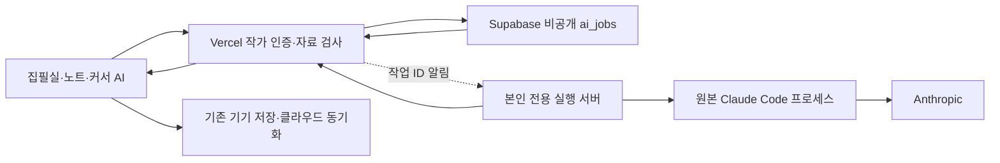

# 개인 구독으로 실행하는 Claude Code 연결 설계

2026-11-01 · 검토안 · 기준 main `5c182fc856434489ed2d94a3e797f15603d328e2`

상태: 설계만 작성했다. 실행 서버·로그인·작업 API·DB 변경은 아직 설치하거나 검증하지 않았다. 현재 동작은 [AI 기능](ai.md), 화면 기준은 [디자인 가이드](design-guide.md)를 따른다.

## 결정과 전제

집필실은 현재 Vercel에 두고, 본인만 사용하는 Linux 실행 서버에 **Anthropic이 배포한 원본 Claude Code**를 설치한다. 작가가 서버 터미널에서 공식 로그인한 뒤 집필실이 작업을 전달한다. 구독 인증을 직접 다루는 Agent SDK 어댑터 대신 원본 CLI의 비대화형 실행을 사용한다.

대화 맥락상 Pro를 가정하지만 실제 플랜·Claude Code 사용 권한은 연결 때 확인한다. Claude·Claude Code에서 쓰는 구독 한도를 공유하며, 정확한 잔여량을 앱이 계산해 표시하지 않는다. API로 자동 전환하지 않는다. 계정의 추가 사용 설정에 따른 요금과 실행 서버 운영비는 별도다.

Anthropic은 원본 바이너리와 공식 인증을 유지하는 호스팅 조건을 명시하는 한편, 자체 앱의 Claude.ai 로그인·구독 자격 증명 중계는 제한한다. 이 설계는 **작가 본인의 전용 실행 환경**을 전제로 한다. 공개 서비스의 구독 중계가 허용된다는 판정으로 확대하지 않는다. 원본 CLI의 인증 수단을 수정·제거하지 않으며, 집필실에는 Anthropic 비밀번호·인증 코드·OAuth 토큰 입력란을 만들지 않는다. [공식 호스팅·인증 조건](https://code.claude.com/docs/en/legal-and-compliance).

## 현재 구현에서 재사용할 것

| 현재 코드 | 설계에서의 역할 |
|---|---|
| [writerClient](../src/lib/server-auth.ts) | 서버에서 작가 로그인과 authors 허용 여부 확인 |
| [chatContext](../src/lib/ai-chat-context.ts) | 서버 저장본·문서 시점·선택 범위·참고 자료 권한 검사 |
| [프리셋 처리](../src/lib/ai-prompt-presets.ts)·[지침](../src/lib/ai-instructions.ts) | 활성 프리셋과 자료/지시 경계 유지 |
| [reviewSchema](../src/lib/ai.ts) | 답변·최대 5개 수정안 검증과 명시적인 원고 적용 |
| [대화 추가](../src/lib/editor-ai-conversation.ts) | 요청을 시작한 문서·노트에 질문/답변을 함께 저장 |

기존 `/api/ai/chat`은 API 키 기반 45초 요청, `maxDuration=60`, JSON 응답이다. 이를 장시간 CLI 프로세스 중계로 바꾸지 않고 별도 비동기 경로를 둔다. API 키 연결과 기존 세 제공자는 계속 기존 경로를 쓴다.

## 구성



- **Vercel:** 작가 인증, 자료 스냅샷 생성, 작업 접수/조회/취소, 결과 검증을 맡는다. 요청을 받아 놓고 함수 종료 뒤 백그라운드 프로세스가 계속 돈다고 가정하지 않는다.
- **Supabase:** 작업과 완료 결과를 보관한다. 기존 Workspace JSON은 실행 대기열로 사용하지 않는다.
- **실행 서버:** 작업 하나씩 CLI를 실행하고 진행/완료를 보고한다. Supabase service-role 키, 작가의 Bearer 토큰, DB 접속 정보는 받지 않는다.
- **브라우저:** 진행 글을 보여주고 검증된 완료 답변을 기존 저장 흐름에 반영한다. 원고 수정은 현재의 적용 버튼·복구 지점·버전 검사를 거친다.

Vercel에서 고정된 실행 서버의 HTTPS 주소로 작업 ID만 알린다. 알림을 받으면 서버는 즉시 접수 응답을 돌려주고 작업을 가져간다. 알림 유실은 실행 서버의 30초 간격 대기열 확인으로 보완한다. 알림 재전송은 같은 작업을 깨우는 동작이며 모델 재호출이 아니다.

공유 비밀은 Vercel과 실행 서버의 통신에만 사용한다. 두 방향을 구분한 비밀을 서버 환경에 보관하고 브라우저에는 전달하지 않는다. 실행 서버 주소는 운영자가 고정하며 요청 본문에서 URL·명령·파일 경로를 받지 않는다. 예고된 실행 서버와 작가 ID의 연결을 Vercel이 확인한다.

## 로그인과 서버 운영

1. 별도 OS 사용자와 영속 디스크가 있는 본인 전용 Linux VM을 준비한다. 자체 PC도 같은 프로토콜로 시작할 수 있지만 꺼지거나 절전 중이면 작업이 멈춘다. 서버 구매·사양 확정은 이 문서에 포함하지 않는다.
2. 공식 Claude Code 배포본의 검증한 버전을 설치한다. 자동으로 최신 버전을 받아 운영하지 않고 프로토콜 회귀 확인 후 갱신한다.
3. 같은 OS 사용자로 `claude auth login`을 실행한다. 작가가 Anthropic 페이지에서 직접 로그인하고, 공식 흐름이 요청하면 코드를 **서버 터미널**에 입력한다. 이 채팅이나 집필실 API를 거치지 않는다.
4. 로그인과 실행이 같은 `CLAUDE_CONFIG_DIR`을 사용한다. CLI가 관리하는 자격 증명 저장소를 유지하고, 브로커는 인증 파일을 읽거나 토큰을 추출하지 않는다.
5. `claude auth status`의 공개 상태를 최소한으로 정규화한다. 계정 이메일·조직 ID·설정 디렉터리·원본 출력 전체는 상태 API로 반환하지 않는다.
6. 본인의 구독 로그인이 활성 상태인지 확인하고 합성 문장 하나로 실제 실행을 시험한다. CLI의 인증 갱신 실패는 `로그인 필요`로 표시하고 공식 로그인으로 복구한다.

CLI의 인증에는 우선순위가 있다. `ANTHROPIC_API_KEY` 등이 있으면 비대화형 실행이 구독 대신 이를 사용할 수 있으므로, 자식 프로세스 환경은 명시적인 허용 목록으로 만든다. 브로커 비밀·API 키·다른 제공자 선택 변수·임의 endpoint는 전달하지 않는다. 예상한 구독 인증과 다르면 작업을 시작하지 않고 상태를 알린다. 원본 CLI에서 다른 공식 인증을 선택하는 기능 자체는 유지한다. [인증 흐름·우선순위](https://code.claude.com/docs/en/authentication).

## 첫 버전의 CLI 실행

첫 연결은 문장 퇴고·요약·브레인스토밍·선택 자료 질문이다. 서버가 허용한 글을 stdin으로 전달하고, 모델의 파일 읽기·셸 실행·외부 검색은 켜지 않는다. 이렇게 해야 전송 범위를 지금의 집필실 선택과 일치시킬 수 있다.

검증할 실행 프로필:

| 항목 | 제안 |
|---|---|
| 실행 | 고정 바이너리에 `spawn`의 인자 배열로 실행, `shell:false`; 원고·질문은 stdin |
| 출력 | `-p --output-format stream-json --verbose --include-partial-messages` |
| 도구 | `--tools ""`, 빈 MCP 구성과 `--strict-mcp-config`, `--disallowedTools "mcp__*"` |
| 기록 | `--no-session-persistence`; 매 요청 새 프로세스, 과거 대화는 집필실의 제한된 history만 전달 |
| 제한 | `--max-turns 3`; 작업 시작 뒤 최대 180초; 표준 출력 총 8MiB·한 줄 1MiB 상한 |
| 결과 | 서버 소유 JSON Schema를 `--json-schema`로 전달하고 최종 결과를 `reviewSchema`로 재검증 |

`--bare`는 공식 문서상 구독 인증을 읽지 않으므로 사용하지 않는다. 대신 이 서버만의 깨끗한 설정 디렉터리와 작업 폴더를 사용해 기존 저장소의 hooks·plugins·MCP·CLAUDE.md가 실행에 섞이지 않게 한다. `--dangerously-skip-permissions`는 사용하지 않는다. `--tools`만으로 MCP까지 차단되는 것은 아니므로 두 범위를 각각 제한한다. 실제 프로세스의 초기 도구/확장 정보도 검사한다. [비대화형 실행](https://code.claude.com/docs/en/headless)·[옵션](https://code.claude.com/docs/en/cli-reference).

180초·3턴·출력 크기는 앱의 초기 제안값이며 Claude 구독 한도가 아니다. 도구를 비운 상태의 JSON Schema 출력·로그인·모델 선택이 실제 배포 버전에서 함께 작동하는지는 첫 실험의 통과 조건이다.

계정에 허용된 모델만 설정에서 고른다. `sonnet` 같은 별칭을 사용하더라도 기록에는 CLI가 보고한 실제 모델 ID를 남긴다. 지원하지 않는 모델이나 CLI 버전이면 실패로 돌려주며 다른 모델·API 키로 조용히 바꾸지 않는다.

원본 stream-json은 그대로 브라우저에 내보내지 않는다. 첫 버전은 대기·생성·재시도 같은 상태만 전달하고, 답변은 최종 `result`의 성공 상태와 `structured_output` 존재·스키마를 모두 확인한 뒤 표시한다. 생각 과정·서명·도구 원문·로컬 경로·인증 출력과 생성 중인 JSON은 노출하지 않는다. 프로세스 종료 코드나 스트림 종료만으로 성공 처리하지 않는다. 답변 본문의 점진적 표시는 후속으로 둔다.

## 요청과 저장 계약

새 연결은 `connectionId: "claude-code"`, 모델 제공자는 기존 값 `provider: "anthropic"`로 구분한다. 실행 경로 때문에 저장용 provider enum에 네 번째 값을 넣지 않는다.

입력은 기존 ChatInput을 재사용하고 바깥에 `requestId`와 `connectionId`를 더한다. 예시:

```json
{
  "requestId": "요청마다 발급하는 UUID",
  "connectionId": "claude-code",
  "chat": {
    "provider": "anthropic",
    "workId": "작품 UUID",
    "docId": "문서 UUID",
    "version": "요청 시점 updatedAt",
    "message": "질문",
    "includeManuscript": true,
    "sourceIds": [],
    "history": [],
    "promptPresetId": "builtin:default"
  }
}
```

문서/노트 분기, 선택/현재 문단, 프리셋·히스토리 규칙은 [기존 계약](ai.md#api)을 따른다. 생성 전에 `writerClient`·`chatContext`·활성 프리셋을 확인하며, 클라이언트가 임의 본문을 실행 서버로 전달하지 못하게 한다.

- 기존 입력 상한인 질문 2,000자, 현재 글 12,000자, 참고 8개/각 1,800자, 이전 대화 10메시지/총 24,000자, 프리셋 4,000자를 유지한다. 클라이언트 요청은 128KiB, 서버가 구성한 실행 스냅샷은 256KiB까지로 검사한다.
- 대기열에는 요청 때 확정한 글·참고 자료·프리셋·모델·대화 기준을 고정한다. 긴 작업 도중 새 원고로 바꿔 끼우지 않는다. 다른 작품·연결되지 않은 자료·휴지통은 현재와 같이 제외한다.
- 한 작가에 실행 1개, 대기 1개로 시작한다. 같은 문서/노트는 미완료 요청 하나만 허용한다. 대기 10분 경과는 실행 전에 만료한다.
- 초기에는 기존 **제공자 합계 하루 10회** 앱 제한을 유지한다. Pro의 구독 한도와 별개다. 제한 변경은 후속 제품 결정이며 이번 연결로 제한을 제거하지 않는다.

## 작업 테이블과 중복 방지

새 `public.ai_jobs`는 Workspace와 별도다. 필드 묶음은 다음과 같다. 실제 SQL은 구현 단계에서 마이그레이션으로 작성한다.

| 묶음 | 값 |
|---|---|
| 식별·소유권 | job ID, owner ID, request ID, connection ID, worker ID |
| 요청 기준 | 원본 scope, 문서 버전, 대화 메시지 ID/내용 해시, 요청 해시, 프리셋 revision |
| 실행 자료 | 검사된 문맥·질문·제한된 history·서버 지침·모델의 불변 스냅샷 |
| 상태·임대 | 상태, claim token, 임대 만료, 시작/종료 시각, 취소 요청 |
| 진행·결과 | 증가하는 seq, 표시용 처리 상태, 검증된 최종 답변, 실제 모델, 오류 코드 |
| 기록 반영 | 생성 때 정한 질문/답변 메시지 UUID, 작업 공간 반영 확인 시각 |

조회는 owner와 상태/생성 시각을 기준으로 색인하고, 오래 보관하는 중복 방지 행이 실행 대기열 조회에 섞이지 않도록 활성 상태의 부분 인덱스를 둔다. 한 문서의 미완료 요청도 유일성 제약으로 보호한다.

`(owner_id, request_id)`를 유일하게 한다. 같은 ID와 같은 요청의 재전송은 기존 작업을 반환한다. 같은 ID의 다른 입력은 409다. 이미 접수한 작업을 다시 받는 것은 생성 검사를 새 문서 버전으로 반복하거나 사용량을 다시 예약하지 않는다.

Vercel이 `writerClient`로 확인한 작가 ID와 검증한 스냅샷을 서버 전용 생성 RPC에 넘긴다. RPC는 authors 소속·기준 Workspace 버전을 확인하고 대기열 자리 확인·사용량 예약·작업 삽입을 **한 트랜잭션**에서 처리한다. 동시 요청은 작가별로 직렬화한다. 기존 `reserve_ai_call`은 auth.uid에 의존하므로 service-role 호출에 그대로 쓰지 않는다. 같은 `ai_usage` 갱신을 재사용하는 비공개 helper를 분리하고, 기존 RPC의 인증·10회 제한 계약은 회귀 검사한다.

예약과 생성을 HTTP 두 번으로 이어 붙이면 네트워크 단절 때 이중 예약할 수 있으므로 그렇게 구현하지 않는다. 입력/권한/대기열 거절은 호출 수를 차감하지 않고, 접수 후 실패·취소는 현재 정책처럼 예약을 유지한다.

테이블은 RLS를 켜고 `anon`·`authenticated`의 직접 Data API 접근 권한을 회수한다. 브라우저는 작가 인증한 Vercel 경로로 자기 작업의 공개 필드만 조회한다. Vercel은 모든 조회/변경을 검증한 owner로 제한하며 claim token·입력 스냅샷·원본 CLI 출력은 응답하지 않는다. 서버 전용 RPC/helper는 `PUBLIC`·`anon`·`authenticated` 실행 권한을 명시적으로 회수하고 최소 서버 역할만 허용한다. worker에는 그 서버 역할 키를 배포하지 않는다.

## HTTP 경계

다음은 제안 경로이며 현재 존재하는 API가 아니다. 브라우저 경로는 작가 Bearer 인증, 변경 요청은 같은 Origin 검사, 모든 응답은 no-store를 사용한다.

| 경로 | 책임 |
|---|---|
| `GET /api/ai/runner/status` | 실행 서버 가용성·로그인 상태·검증한 CLI 버전·모델을 최소한으로 반환. AI 호출 없음 |
| `POST /api/ai/jobs` | 검사·중복 확인·접수, 202와 job ID 반환 |
| `GET /api/ai/jobs` | 본인의 대기/실행/미반영 결과 목록 |
| `GET /api/ai/jobs/:id` | 상태·seq 또는 최종 답변. 다른 소유자는 404 |
| `POST /api/ai/jobs/:id/cancel` | 실행 중지 요청 또는 미반영 완료 답변 버리기 |
| `POST /api/ai/jobs/:id/ack` | 질문/답변의 실제 클라우드 저장 확인 후 작업 자료 정리 |

서버 간에는 별도 내부 claim/progress/complete 경로를 둔다. owner는 임의 입력이 아니라 등록된 실행 서버의 고정 작가 ID로 정한다. 보고에는 job ID·claim token·seq를 대조한다. `/notify`는 실행 서버에 존재하며 고정 URL과 서버 간 비밀로 보호하고 작업 ID만 받는다.

브라우저는 실행 중에만 1초 간격으로 상태를 조회하고 대기 중에는 3초로 늘린다. 진행 보고도 최대 초당 한 번 묶어 저장한다. 매번 모델 스트림 전체를 DB에 덧붙이지 않고 최신 처리 상태·seq만 보관한다. SSE는 나중에 같은 상태 위에 추가할 수 있으며, 브라우저 연결이 끊겨도 모델을 재실행하지 않는다.

## 실행 상태와 장애

```text
queued → leased → running → succeeded → acknowledged
                    ├→ cancel_requested → cancelled
                    ├→ failed
                    └→ interrupted
queued → expired
succeeded → discarded
```

- 임대는 30초, 실행 중 heartbeat는 5초로 시작한다. claim token으로 이전 프로세스의 늦은 완료 보고를 거절한다.
- 시작 전 leased 상태의 임대 유실은 재접수할 수 있다. running 이후에는 재시작 시 `interrupted`로 남겨 작가가 새 요청으로 다시 실행한다. 실제 모델 호출의 exactly-once는 보장하지 않으며 장애 복구가 구독을 중복 소비하지 않도록 자동 재호출을 하지 않는다.
- CLI 자체의 네트워크 재시도는 새 작업을 만드는 재실행과 구분한다. 원본 프로세스의 재시도 상태를 표시하고 작업 시간 상한에 포함한다.
- 취소는 즉시 UI에 반영한다. worker는 진행/heartbeat 응답의 취소 신호를 받아 프로세스에 SIGINT를 보내고, 5초 안에 멈추지 않으면 프로세스 트리를 종료한다. 외부 제공자에서 이미 처리한 사용량을 되돌린다고 표시하지 않는다.
- 취소와 완료는 같은 행의 조건부 상태 전이로 처리한다. 취소가 접수된 결과는 자동 기록하지 않는다. 이미 대화에 보관한 결과라면 그 기록을 취소가 삭제하지 않는다.
- 인증 만료·구독 한도·출력 오류·시간 초과를 각각 구분한다. 질문과 원고는 유지하고, API나 다른 모델로 자동 전환하지 않는다. 잔여 구독량을 읽을 공식 계약이 없으면 임의 숫자를 만들지 않는다.

## 대화 저장·탭 전환·복구

현재 앱은 전체 Workspace 버전으로 동기화한다. 실행 서버가 완료할 때 Workspace를 별도로 덮어쓰면 집필 중인 변경과 충돌할 수 있으므로, **결과는 job에 먼저 보관하고 기존 클라이언트 저장 경로로 대화에 추가**한다.

1. 작업 관찰은 AIChat 컴포넌트 수명이 아니라 Studio 범위에서 관리한다. 문서를 바꿔도 처음 scope와 메시지 기준을 유지한다.
2. 정상 완료 시 현재 대화의 ID/내용 해시를 확인하고 질문/답변을 함께 추가한다. 원고만 바뀐 경우 답변은 원래 version을 가진 채 보관하되, 수정 적용은 기존 버전 검사로 막는다.
3. 요청 때 정한 메시지 UUID를 사용해 두 탭·재접속·재전송에서 중복 추가를 막는다. 기존 메시지 수 검사만으로 새 대화·동일 길이 편집을 구분할 수 없으므로 해시도 검사한다.
4. `flush`만으로 완료하지 않고 클라우드 동기화 후 ack를 보낸다. 서버는 실제 저장본에 같은 scope·UUID·내용의 쌍이 있는지 확인한다. 없으면 job 결과를 유지한다.
5. 새로고침 뒤에는 미반영 답변을 찾아 보여주고 작가가 **대화에 보관**을 선택하게 한다. 새 대화·삭제된 문서에 예전 답변을 자동으로 되살리지 않는다. 기준이 달라진 대화는 답변 보기/복사로 복구한다.

커서 AI는 기존 삽입/교체 범위를 그대로 검사한다. 원래 편집기·선택 범위가 사라진 뒤에는 자동 삽입하지 않고 원래 문서의 답변 보기로 복구한다. 프리셋·스킬·자료 선택은 기존 규칙을 공유한다.

## 화면과 데이터 보관

AI 설정의 현재 위치에 **Claude API**와 **Claude Code** 연결을 구분한다. Code에는 `연결됨`, `로그인 필요`, `서버 연결 안 됨`, `사용 한도` 상태와 **연결 확인**만 둔다. 서버 주소나 토큰 입력을 일반 집필 UI에 노출하지 않는다. 제공자 대신 내부적으로 connection을 선택하고 결과의 저장용 provider는 anthropic으로 유지한다.

오른쪽 AI 대화·커서 창·선택 글 우클릭은 같은 실행 선택을 사용한다. 생성 중에만 중지 동작과 짧은 상태를 표시한다. 미반영 결과는 AI 영역에서 확인하며 원고 위 고정 막대·드래그 아이콘·상시 저장 안내를 추가하지 않는다. 기존 Select·Modal·Popover·버튼을 사용한다.

| 자료 | 보관·백업 |
|---|---|
| 정상 질문/답변 | 기존 Workspace 대화 형식 유지. API/CLI 모두 실제 모델 ID를 기록하며 ZIP·Drive·DB 백업에 포함, 공개판 제외 |
| 실행 경로 정보 | job과 현재 연결 상태에 보관. 첫 버전의 과거 대화/ZIP만으로 API와 CLI 실행 경로를 구분하지 못함을 명시 |
| 미정리 종료 작업 | 성공 결과·실패한 질문을 보관 또는 버리기 전까지 자동 삭제하지 않음. 작가당 최대 20개가 쌓이면 새 작업을 막고 먼저 정리 |
| 실행 입력 스냅샷 | 종료 뒤 신속히 정리. 질문·자료 제목/ID·version 등 결과 보관과 질문 복구에 필요한 값은 남김 |
| 반영/버리기 완료 job | 내용 제거 후 중복 방지용 ID·요청 해시·상태는 유지. 이 묘비 행을 지운 뒤 같은 ID를 새 실행으로 인정하는 만료 정책을 도입하지 않음. 새 실행은 새 요청 ID 사용 |
| CLI 자격 증명 | 원본 CLI가 실행 서버에 관리. Workspace·브라우저·애플리케이션 ZIP·원고 백업에 넣지 않음 |

진행 중 작업과 미반영 결과는 아직 정상 대화가 아니므로 앱 ZIP/Drive ZIP에 들어가지 않는다. `public.ai_jobs`는 현재 [DB 덤프](../scripts/disaster-backup.mjs)의 public 데이터 범위에 포함될 수 있으므로 구현 시 수집·복원 훈련에서 확인한다. DB 백업에 남은 스냅샷이 live 행 정리와 동시에 사라진다고 설명하지 않는다. DB 복원 뒤 대기/실행 작업은 중단 상태로 바꾸고 자동 실행하지 않으며, 완료 결과는 기존 메시지 UUID와 대조해 중복을 막는다.

원고·질문·모델 원본 출력·자격 증명은 일반 운영 로그에 남기지 않는다. CLI의 `--no-session-persistence`만으로 모든 네이티브 로그가 없어진다고 가정하지 않고 실험에서 확인한다. 실제 전송·보관 경계는 구현과 함께 개인정보 안내와 운영/복구 문서에 반영한다.

## 구현 순서와 통과 조건

1. **본인 실행 환경의 실험:** 원본 버전 고정, 공식 구독 로그인, 합성 문장 한 번 실행, 실제 인증/모델 확인. `--bare` 없이 도구 차단·구조화 출력·스트림 종료·로그 보관을 검사한다. 이 단계 전에는 구독 연결이 작동한다고 표시하지 않는다.
2. **작업 API와 실행 서버:** 테스트 DB에 jobs/RLS/RPC를 만들고 중복 접수·한도 예약 원자성·임대·취소·결과 검증을 시험한다. 자식 프로세스는 먼저 모의 CLI로 제어하고 실계정 호출 횟수를 최소화한다.
3. **집필실 연결:** AI 설정·대화·커서/우클릭을 연결하고 기존 저장·수정 적용·백업과 함께 검증한다. 계정 연결과 한도 확인을 마친 뒤 본인에게만 활성화한다.

운영 활성화는 별도 서버 설정으로 제어한다. 끄면 신규 접수·claim을 멈추고 기존 API 연결을 유지한다. 실행 중 작업은 정상 종료 또는 명시적 중지로 정리하며, 미반영 답변은 복구할 수 있게 남긴다. 실행 서버 교체·롤백이 새 추론을 자동 시작하게 만들지 않는다.

필수 회귀:

- 익명/다른 작가·다른 runner의 job 조회/취소/완료 거절, 원고·키·토큰 미노출.
- 같은 request ID 동시 요청에서 job 1개·앱 호출 예약 1회. 입력 거절/대기열 가득 참은 예약 0회.
- stale 문서/선택·다른 작품 자료·변경된 프리셋 거절, 요청 뒤 편집한 원고 보존.
- 분할·노트·문서 탭 전환, 두 브라우저, 새 대화, 삭제/휴지통, 완료와 취소의 동시 처리.
- reload/연결 단절 뒤 결과 복구, 메시지 UUID 중복 방지, 클라우드 저장 실패 시 ack 거절.
- 로그인 만료·구독 제한·CLI 비정상 종료·잘못된 JSON·출력 크기·시간 초과에서 자동 API 전환 0회.
- worker 시작 전/후 장애, 임대 유실 뒤 늦은 결과 거절, 실제 모델 재호출 여부를 구분.
- API 세 제공자와 기존 호출 한도 회귀, 정상 대화의 ZIP/Drive/DB 왕복·공개 제외.
- 새 화면의 54개 테마·360px·키보드/초점·중지/재접속 실제 조작.

후속은 작가가 고른 문서·노트만 조회하는 제한된 도구부터 검토한다. 전체 작업 공간 검색·여러 문서 수정·원고 자동 적용·다른 사용자의 구독 중계·Codex/Gemini 실행기는 이번 첫 연결에 포함하지 않는다.
