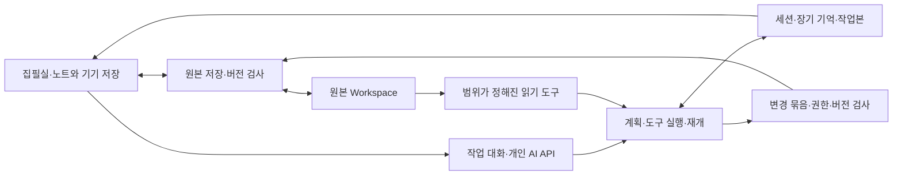

# 개인 집필 에이전트 설계

2026-11-09 · 전체 목표와 단계별 설계 · 시작 기준 main `2c111c9`

작업 세션·도구·변경 묶음·기억·Gemini 웹 조사의 첫 구현을 추가했다. 현재 제공 범위·서버 설정·제약은 [집필 작업 대화](writing-agent.md), 수행한 검사와 미검증 항목은 [검증 기록](../VERIFICATION.md)이 기준이다. 아래 위키·확장 도구·다중 범위·ZIP 복원 항목에는 후속 목표가 포함되어 있다.

집필실과 노트를 작업 공간으로 사용하는 개인 집필 에이전트를 만든다. 대화로 목표를 주면 관련 자료를 찾고, 필요한 작업을 계획하고, 문서·노트·구조를 다루며 진행한다. 작가가 막혔을 때는 가정을 되묻거나 다른 전개를 제안하고, 이전에 선택·보류한 이유를 기억해 다음 대화로 이어 간다. 사용자 한 명이 기존 작가 계정으로 쓰는 비서이자 창작 동료를 전제로 한다.

LLM Wiki는 에이전트가 사용하는 장기 기억 중 하나다. 제품의 중심은 이어지는 작업 대화와 실제 행동이며, 위키를 먼저 완성해야 에이전트를 쓸 수 있는 구조로 만들지 않는다.

## 원하는 사용 경험

코드 에이전트와 대응하는 작업 단위는 다음과 같다. 특정 제품의 내부 구현을 복제한다는 뜻은 아니다.

| 개발 작업의 개념 | 집필 작업에서의 대응 |
|---|---|
| 저장소의 파일·폴더 | 작품·설정·노트·섹션·문서 트리 |
| 이어지는 작업 세션 | 목표·대화·결정·열린 문제를 보관한 집필 세션 |
| 파일 탐색·편집 도구 | 원문 검색·참조 조회·문서 생성·부분 수정·구조 정리 |
| 변경 비교·작업 사본 | 여러 문서에 걸친 변경 묶음과 적용 전 작업본 |
| 프로젝트 지침·검사 | 작가의 작업 원칙·작품 규칙·출처 확인·설정 대조 |

예를 들어 ‘이 아이디어를 장편으로 키워 보고 싶은데 뻔한 방향은 피하고 싶어’라고 시작할 수 있다. 에이전트는 관련 노트와 이전 구상을 찾아 연결하고, 먼저 의논할 갈림길을 짚고, 여러 방향의 개요를 만들어 비교한다. 사용자가 한 방향을 고르면 작업을 계속하고, 요청에 따라 설정 노트·개요 문서를 만들거나 기존 구상을 정리한다. 다음 날 ‘어제 두 번째 방향을 뒤집어 보자’라고 말해도 같은 세션에서 이어진다.

‘2부의 시간순서를 맞추고 관련 설정도 정리해줘’라는 실행 요청에는 자료 읽기 → 계획 → 문서 수정 → 관련 설정 재검토 → 변경 비교와 요약까지 수행한다. 문서마다 질문을 새로 만들거나 작가가 파일을 하나씩 붙이는 절차를 요구하지 않는다.

## 대화·행동·뮤즈의 역할

에이전트의 능력과 이번 작업에서 허용한 행동을 구분한다. 도구는 문서를 생성·수정할 수 있고, ‘어떻게 생각해?’라는 대화를 곧바로 원고 변경 요청으로 해석하지 않는다. ‘개요를 문서로 정리해줘’처럼 결과를 남기는 요청은 해당 범위의 실행 지시로 다룬다.

| 작업 방식 | 동작 |
|---|---|
| 함께 생각하기 | 관련 기억을 찾아 대화하고, 대안·반론·질문을 제안. 문서 변경은 실행 방식 전환 후 요청 |
| 변경을 검토하며 실행 | 여러 문서의 변경을 작업본에 만들어 스스로 대조한 뒤 한 묶음으로 제시 |
| 범위를 맡겨 실행 | 이번에 허용한 문서·행동을 직접 반영하고 결과와 되돌리기를 제공 |

이 선택은 실행 권한에 관한 것이다. 창작 성향은 별도로 정한다. 비서처럼 검색·정리하는 요청과 뮤즈처럼 가능성을 넓히는 요청을 같은 세션에서 오갈 수 있다. 처음부터 모든 문장을 대신 쓰는 성향을 고정하지 않고, 요청한 경우 초안·개작까지 수행할 수 있게 한다.

뮤즈 역할에는 낯선 연결 찾기, 이야기의 전제 뒤집기, 인물의 욕망·두려움 탐색, 구조 실험, 작가의 의도에 대한 반론이 포함된다. 창작 아이디어에 기존 원문의 증거를 요구하지는 않는다. 기존 설정에 대한 설명과 새 제안을 구분하고, 반복해서 거절한 방향과 그 이유를 다음 제안에 반영한다. 인물 시뮬레이션도 실제 인물이나 원고의 사실이 아닌 탐색으로 취급한다.

작업 중 사용자가 새 말을 보내면 진행을 멈추거나 수정해 반영할 수 있어야 한다. 이미 준비한 변경은 보존하며 새 지시가 이전 범위·목표와 충돌하는지 확인한다. 자발적인 관련 노트·미해결 문제 제안은 사용자가 켠 경우 적절한 작업 시점에만 제공하며, 타이핑마다 말을 걸거나 상시 평가하지 않는다.

## 결정

| 항목 | 첫 구현의 선택 |
|---|---|
| 서버 | 기존 Next.js 앱에 개인 AI API를 추가하고, 긴 작업은 Vercel Workflow에서 실행 |
| 원본 | 기존 Workspace JSON·IndexedDB·버전 검사를 유지하고 에이전트용 변경 묶음 반영 추가 |
| AI 자료 | 같은 Supabase 프로젝트의 별도 테이블에 세션·작업본·기억·실행·결과 보관 |
| 모델 | Vertex AI의 Gemini·Claude 중 작업마다 하나를 선택 |
| 검색 | 기존 텍스트 검색·내부 참조·위키 목차부터 재사용, 벡터 DB는 보류 |

기존 코드를 확장하는 작업이다. 새로운 SaaS, 별도 회원 체계, 팀 권한, 사용자별 과금, 상시 실행 서버를 먼저 만들지 않는다. 배포·복구할 서비스 수를 늘리지 않으면서 실행부를 나중에 옮길 수 있는 경계를 만든다. 현재 Vercel 플랜의 Workflow 사용 가능 여부·한도·요금과 실제 모델 지원은 구현 시 다시 확인한다.

## 현재 코드에서 확인한 출발점

- [원본 모델](../src/lib/model.ts): 작품 문서와 독립 노트는 Workspace에 있고, 계정 전체 저장 버전을 공유한다. 문서의 `updatedAt`과 원고 상태가 있지만 확정 설정 여부를 나타내는 필드는 없다. `done`을 세계관의 사실 확정으로 해석하지 않는다.
- [저장](synchronization.md): 브라우저가 IndexedDB에 기록한 뒤 Supabase `save_workspace` RPC로 전체 작업 공간을 전송한다. 모든 원고 쓰기가 Next.js API를 통과하는 구조가 아니다.
- [현재 AI API](../src/app/api/ai/chat/route.ts): 작가 인증·서버 저장본·선택 자료를 확인한 후 한 번의 제공자 요청을 실행한다. route의 `maxDuration`은 60초다. 이는 현재 앱 설정이며 Vercel 전체의 최대 실행 시간이라는 뜻이 아니다.
- [제공자 어댑터](../src/lib/ai-provider.ts): Vertex AI의 Google·Anthropic publisher를 같은 GCP 프로젝트로 호출한다. 현재 `Review` 응답 계약은 대화·최대 5개 수정 제안용이며 위키나 도구 호출 계약으로 그대로 사용하지 않는다.
- [AI 연결](ai.md): 서버 OIDC/WIF 인증과 브라우저의 모델 선택을 분리한다. 쿠키에는 모델 ID만 보관하고 Workflow 단계 안에서 단기 OAuth 토큰을 만든다.
- [전체 검색](../src/lib/workspace-search.ts)·[내부 참조](internal-references.md): 활성 문서의 제목·본문·속성·경로와 `@` 연결을 재사용할 수 있다. 현재 검색은 브라우저 안에서 실행하며, 에이전트용 서버 검색은 새로 제공해야 한다.
- [기존 참고 범위](../src/lib/ai-chat-context.ts): 작품 대화는 같은 작품 자료, 노트 대화는 다른 노트와 연결 작품을 명시적으로 선택한다. 새 에이전트의 자료 접근은 별도 동작으로 추가하며 기존 대화의 범위를 몰래 넓히지 않는다.

이전 개념도의 ‘Orbiter API’는 새로 만들 자료 접근 경계를 뜻한다. 현재의 원고 저장 경로를 전부 서버 API로 이관한다는 의미가 아니다.

## 원본·위키·실행의 관계

노트·집필실에 저장된 문서가 원본이다. 에이전트가 작성한 내용도 허용된 변경을 반영한 뒤 이 저장소의 버전으로 관리하며, 별도 서버 파일을 또 하나의 정본으로 두지 않는다. 서버에서 실행하는 에이전트는 **클라우드 저장이 확인된 버전**을 읽는다. 오프라인에만 있는 수정은 읽었다고 표시하지 않는다. 작업 시작 전 기존 동기화를 마치고, 충돌이 남으면 해당 버전으로 작업을 시작하지 않는다.

에이전트는 원본을 바탕으로 작업본과 변경 묶음을 만든다. 허용한 방식에 따라 검토 후 적용하거나 맡긴 범위에서 바로 반영한다. 실제 쓰기는 모델의 자유로운 덮어쓰기 대신 복구 지점·대상 버전·소유권을 검사하는 변경 실행기를 거친다. 위키는 이 원본을 바탕으로 만든 파생 자료다.

위키를 다시 만들 수 있다고 실행 기록까지 버려도 되는 것은 아니다. 검토 결과, 사용자가 고른 해석, 보류한 제안에는 별도의 보관·내보내기가 필요하다.

## 작업 세션과 기억

세션은 문서에 종속하지 않는다. 한 작품의 여러 원고·설정·노트를 오가고, 공통 아이디어를 탐색하는 세션도 만들 수 있다. 문서를 바꿔 열어도 대화와 목표가 사라지지 않는다. 같은 작품에서 다른 방향을 시험하고 싶으면 이전 결정과 자료를 기준으로 세션을 분기할 수 있다. 분기는 원본 전체를 복제하는 대신 독립 작업본·목표를 가진다.

세션에는 목표, 사용자 메시지와 답변, 간단한 계획, 진행 중·완료한 일, 참조한 자료, 변경 묶음, 선택·보류 이유를 남긴다. 숨은 내부 추론을 저장하는 대신 사용자가 검토할 수 있는 작업 기록을 남긴다. 문맥이 길어지면 원문 기록을 보존한 채 확인 가능한 요약과 관련 부분 검색으로 이어 간다.

장기 기억은 세 종류로 나눈다. 첫째는 인물·개념·설정을 정리한 LLM Wiki, 둘째는 이번 작업의 목표·선택·미해결 문제, 셋째는 사용자가 확인한 작업 취향과 지침이다. 한 번 한 말을 영구적인 취향으로 확정하지 않고 기억 항목을 보고 수정·잊기 할 수 있게 한다. 기존 문서별 AI 대화는 자동으로 전부 기억에 넣지 않으며 사용자가 세션으로 가져오는 경로를 제공한다.

## 두 가지 위키 범위

### 공통 지식 위키

작품에 소속되지 않은 개념·자료·착상·질문을 정리한다. 예를 들면 기억 외부화, 무한, 가상현실 같은 개념 사이의 연결을 찾는다. 최초 설정에서 사용할 노트 작업공간을 고른다. 새로운 작업공간이나 작품을 자동으로 전체 전송 범위에 넣지 않는다.

자료 자체의 요약, 여러 자료를 합친 해석, 작가에게 남은 질문을 구분한다. 특정 작품에서만 성립하는 설정은 작품 범위를 붙이고 일반 지식으로 합치지 않는다.

### 작품별 위키

선택한 작품의 원고·설정·메모와 사용자가 포함한 노트를 읽는다. `linkedWorkIds`와 `@` 참조는 관련 자료 후보를 찾는 데 쓰며, 연결만으로 다른 작품 전체의 접근 권한이나 확정 설정 지위를 부여하지 않는다. 첫 범위 설정에서 포함할 자료를 확인한다.

인물, 장소·조직, 기술·규칙, 사건·연표, 복선·회수, 미해결 사항을 문서가 쌓이는 만큼 만든다. 빈 항목을 채우려고 설정을 지어내지 않는다. 같은 이름의 인물도 작품이 다르면 별개의 대상으로 취급하고, 동명이인·별칭이 모호하면 합치지 않는다.

두 범위는 같은 실행부와 위키 저장 형식을 쓴다. 작품에서 공통 지식을 참고할 때에도 참고한 페이지와 원본 범위를 기록한다.

## 설정과 아이디어를 구분하는 법

개인 노트에는 가설과 폐기할 구상도 있으므로 모든 문장을 동일한 사실로 다루면 안 된다.

| 구분 | 처리 |
|---|---|
| 원문에 적힌 내용 | 원문 출처를 붙인다. 원고 속 발언·믿음과 작품 세계의 사실을 구분한다. |
| 사용자가 확정한 설정 | 사용자가 지정한 자료·문장에만 확정 지위를 준다. |
| 아이디어·대안 | 여러 선택지를 함께 보존하고 채택된 설정으로 승격하지 않는다. |
| AI의 해석·충돌 후보 | 해석 또는 확인할 문제로 표시하고 근거를 함께 보여준다. |

자료의 역할은 우선 위키 범위 설정의 `sourceRoles`로 보관한다. 모든 노트에 필수 메타 항목을 추가하지 않는다. 역할을 지정하지 않은 글을 AI가 스스로 ‘확정 설정’으로 만들 수는 없다. 설정과 원고가 어긋나면 양쪽을 보여주며 작가에게 선택을 남긴다.

서술 시점·등장인물의 오해·의도적인 거짓말·다른 초안도 모순처럼 보일 수 있다. ‘설정 오류’라는 단정 대신 서로 다른 진술과 가능한 해석을 제시한다. 작품별 시간 표현은 원문을 남기며, 추정 날짜와 명시된 날짜를 구분한다.

AI 분석을 보관해도 기존 설정의 유일한 증거로 사용하지 않는다. 기존 글에 관한 설명은 원문까지 출처를 따라갈 수 있어야 한다. 새 설정을 채택하라는 요청을 받으면 에이전트가 허용한 방식으로 원본 노트·설정 문서에 반영할 수 있다. AI가 만든 문서·부분 수정의 생성 출처와 사용자가 채택한 시점을 보존한다.

## LLM Wiki의 동작

### 정리

에이전트가 작업에 필요한 범위를 읽고 관련 위키를 만들거나 갱신할 수 있다. 사용자가 **위키 갱신**으로 직접 정리할 수도 있다. 선택 범위에서 변한 문서를 읽어 자료 요약·개념·인물 페이지를 갱신하고 목차·페이지 연결·변경 이력을 함께 저장한다. 원본을 Markdown 파일로 따로 복제해 두 번째 편집 장소를 만들지는 않는다.

문서별 fingerprint는 내용을 정규화한 해시와 범위 메타데이터 해시로 계산한다. 본문·제목·설정 관련 속성·참조·소속 변경을 추적하고, 단순 AI 대화 추가·보기 설정·즐겨찾기·시각만 바뀐 저장 때문에 원고 전체를 다시 읽히지 않는다. `updatedAt`만으로 같은 내용 여부를 판단하지 않는다.

원본 ID와 fingerprint의 목록을 이전 성공 실행과 비교해 추가·변경·제외된 문서를 계산한다. 관련 위키를 먼저 갱신하고 새로 생긴 관련 페이지도 검사한다. 의존 관계가 불완전하면 해당 범위를 넓혀 다시 점검하고, 모든 페이지의 최신성을 보장했다고 과장하지 않는다. 전체 재정리도 명시적으로 실행할 수 있다.

### 질문과 축적

위키 목차·관련 페이지를 먼저 보고 필요한 원문을 추가로 읽는다. 기존 검색의 일치 구절, 제목·태그, `@` 연결과 위키 역참조를 사용한다. 위키 요약에 없는 세부는 원문에서 확인하며 위키만 보고 원문 전체를 검토했다고 답하지 않는다.

질문의 답은 기본적으로 세션 기록에 남긴다. 근거가 있는 새로운 종합은 위키에 반영할 수 있고, 새 창작 아이디어는 아이디어로 남긴다. ‘이 해석을 채택’ 같은 사용자의 결정은 허용한 방식의 원본 반영으로 이어져 다음 정리에 반영된다.

### 점검

오래된 출처, 사라진 문서, 근거 없는 진술, 끊긴 연결, 중복 대상과 충돌 후보를 점검한다. 최신성·링크 검사는 가능한 부분을 결정적인 코드로 처리하고, 해석이 필요한 충돌만 모델에게 맡긴다. 위키 점검과 원고의 문학적 완성도 평가는 별개다.

### 출처 형식과 최신성

각 진술에는 `sourceId`, 문서 종류, 작품 또는 노트 작업공간 ID, 원본 내용 해시, 가능한 경우 `blockId`, 인용문과 인용 해시를 남긴다. 제목·경로는 읽기 편한 표시값이며 문서 ID를 대신하지 않는다. 위치 숫자는 정규화 텍스트 기준으로 정의하며 ProseMirror 위치와 혼용하지 않는다.

인용문은 모델이 준 값을 그대로 믿지 않고 고정한 입력에서 실제로 찾는다. 중복 인용·이동한 문단은 모호함을 표시하며, 현재 문서와 다르면 과거 출처로 보여준다. 이름만 바꾼 문서의 링크는 ID로 유지하고 표시값을 새로 읽는다.

휴지통·영구 삭제·범위 제외된 문서는 새로운 검색·답변의 근거에서 즉시 제외하고 관련 페이지를 오래된 상태로 만든다. 사용 시점에도 현재 범위를 검사해서 다음 정리 전의 위키가 제외된 자료를 계속 제공하지 않게 한다. 과거 검토 결과는 당시 버전의 기록으로 남고 새 답변의 활성 근거로 자동 재사용하지 않는다.

## 소설 작업 하네스

하네스는 목표·기억·작업본을 바탕으로 모델이 다음 행동을 선택하고, 도구 결과를 보고 계획을 바꾸며 작업을 이어 가는 실행 구조다. 고정된 세 개의 분석 버튼으로만 구성하지 않는다. 첫 버전은 하나의 실행부가 상황에 맞는 지침·도구를 사용하고 여러 에이전트의 병렬 실행은 뒤로 둔다.

| 작업 | 요청 예 | 결과 |
|---|---|---|
| 작업 비서 | 흩어진 구상을 모아 개요 문서를 만들고 노트를 정리해줘 | 관련 자료 탐색·문서 생성·구조 변경 |
| 작품 편집 | 2부의 사건 순서를 바꾸고 관련 설정도 맞춰줘 | 여러 문서의 변경 묶음·대조 결과·되돌리기 |
| 창작 동료 | 이 전제를 뒤집으면 더 흥미로울까? | 반론·새 연결·전개 실험·선택 이유의 기억 |
| 자료·기억 관리 | 지난번 선택과 새로 쓴 내용까지 정리해줘 | 세션 기억·갱신된 위키·열린 질문 |

작업은 목표 파악 → 자료 탐색 → 필요한 계획 → 도구 실행 → 결과 대조 → 후속 행동으로 이어진다. 필요하면 이 순환을 반복하거나 사용자와 논의한다. 탐색 중 필요한 자료를 더 읽을 수 있지만 허용한 범위를 넘지는 못한다. 기존 설정을 확인하지 못하면 모른다고 남기고, 창작 제안이 필요한 경우에는 새 가정을 명시해 탐색한다. 같은 도구 호출을 반복하며 진행이 없는 경우 멈춘다.

주어진 문장만 다듬는 기존 빠른 AI 질문은 그대로 둔다. 긴 실행은 작업 ID를 반환하고 브라우저가 닫혀도 서버에서 계속 진행한다. 다시 열면 같은 세션의 상태와 결과를 읽는다. 검토하며 실행하는 방식은 작업본까지 진행하고, 맡겨 실행하는 방식은 서버의 변경 반영 검사까지 진행한다. 문학적 판단의 정답을 보장하지 않으며 작업 의도·변경 내용·근거와 새 제안의 구분을 검증 기준으로 삼는다.

### 첫 도구 목록

- `searchSources`: 허용한 원문·위키에서 관련 항목과 일치 구절 찾기.
- `readSource`: 고정한 원본 ID·버전과 세션 작업본을 합쳐 본문·속성 읽기. 스스로 만든 변경도 다음 행동에서 확인.
- `readWikiPage`: 출처와 최신 상태가 확인된 위키 읽기.
- `findReferences`: 범위 안의 명시적 참조·백링크 조회.
- `searchWeb`: 작업에 필요한 외부 자료 검색. 검색어·출처 URL·제목·제공된 날짜를 기록.
- `readWebPage`: 검색 결과나 사용자가 준 공개 페이지를 읽고 실제로 확인한 내용과 인용 위치를 반환.
- `createDocument` / `createNote`: 허용한 위치에 새 문서를 작업본으로 생성.
- `editBlocks`: 정확한 대상 버전과 문단을 지정해 부분 수정.
- `updateMetadata` / `moveDocuments`: 제목·속성·폴더와 문서 구조를 작업본에서 정리.
- `inspectChanges` / `validateChanges`: 변경 전후·참조·모델 형식·설정 영향 확인.
- `commitChanges`: 세션에 허용된 쓰기 범위와 적용 방식을 검사한 뒤 변경 묶음 반영.
- `stageWikiChanges`: 위키 변경안을 준비. 모델이 현재 페이지를 직접 덮어쓰지 않음.
- `saveResult`: 근거·검토 범위·미검토 구간을 갖춘 보고서나 수정 제안 보관.

문서·위키 변경안은 코드의 스키마·권한·대상 버전 검사를 통과한 뒤 반영한다. 기존 원문에 관한 인용은 출처도 확인하며 새 창작 문장 자체에 과거 인용을 요구하지 않는다. 영구 삭제·게시·외부 메시지 전송·임의 SQL·셸 실행은 첫 도구 목록에 없다. 사용자 요청과 자료 안의 지시문을 구분하고 원문에 쓰인 ‘다른 자료를 공개하라’ 같은 문장을 실행 지시로 취급하지 않는다.

### 웹 조사

웹 검색·공개 페이지 읽기는 첫 구현의 기본 도구에 포함한다. 예를 들어 ‘기억 이식에 관한 연구를 찾아 이 설정의 허점을 검토해줘’라는 요청에 검색 → 원문 확인 → 여러 출처 대조 → 작품 설정과 비교 → 출처가 있는 자료 노트 작성까지 수행할 수 있다. 새 자료를 노트에 남기거나 설정 문서를 고치는 행동은 이번에 허용한 쓰기 범위를 따른다.

검색 도구와 페이지 읽기는 모델 선택에서 분리한 공통 도구로 제공한다. 구체적인 검색 서비스·인증·요금·모델의 내장 검색 지원은 구현 시 공식 문서와 실제 응답으로 확인한다. 본문을 읽지 못했으면 검색 결과 요약만 본 사실을 표시하고, 유료·로그인 페이지나 PDF 전문을 읽었다고 주장하지 않는다. 첫 버전은 공개 텍스트 페이지를 대상으로 하며 PDF 본문 추출·OCR은 별도 확장이다.

자료에는 출처 URL·접근 시각·확인 가능한 작성/갱신일·확인한 인용을 남긴다. 원고 전체를 검색어로 보내지 않고 필요한 개념으로 검색한다. 페이지 내용은 자료로 취급하며 도구 실행 지시로 사용하지 않는다. 페이지 읽기는 공개 HTTP(S) 주소와 redirect를 검사해 내부망·로컬 파일·인증정보에 접근하지 못하게 한다. 외부 자료의 주장, 과학적 근거의 불확실성과 소설에서 채택한 가정은 구분한다.

## 서버와 모델 선택

Next.js Route Handler는 기존 작가 인증을 사용해 세션·목표·범위·이번 작업의 읽기/쓰기 권한·원본 버전을 확인하고 실행을 등록한다. 다단계 작업은 Vercel Workflow로 분리한다. 업무 데이터 접근 도구는 공통 서버 모듈로 두며 같은 배포 안에서 단계마다 자기 HTTP API를 호출할 필요는 없다. 에이전트의 성격과 작업 지침, 기억 선택, 도구 범위, 실행 기록을 모델 호출과 분리해서 관리한다.

일반 문서·노트·커서 AI와 작업 대화 모두 AI SDK의 Vertex 어댑터를 사용한다. 즉시 대화의 기존 자료 범위·구조화 결과는 유지한다. 에이전트의 도구 호출·사용량·작업 재개는 Workflow 통합이 담당한다.

API는 Google Cloud `orbiter-ai` 프로젝트로 통일한다. Gemini·Claude 모델 중 작업마다 하나를 고르며 웹 조사는 Vertex Gemini를 사용한다. 다른 직접 API나 AI Gateway로 자동 전환하지 않는다. 모델 ID는 시작 시 고정한다. 구독 로그인·Codex·Claude Code 설치는 필요하지 않다.

Vercel OIDC와 GCP Workload Identity Federation으로 서비스 계정의 단기 OAuth 토큰을 발급한다. 인증은 서버 단계에서만 사용하고 Workflow에는 제공자·모델 ID만 직렬화한다. 브라우저에 저장한 모델 ID는 작업 시작 시 읽어 실행에 고정한다. 인증 토큰이나 서비스 계정 키를 기록·백업·브라우저에 보관하지 않는다. [구성](vertex-ai.md).

Python·별도 CLI·프로세스 환경이 실제로 필요해지면 실행부를 GCP `Orbiter AI` 프로젝트의 Cloud Run Jobs 등으로 옮긴다. 새 공개 API 서버를 의무적으로 추가하지 않고, 실행부가 동일한 자료 접근 계약을 사용하게 한다. Cloud Run으로 옮기면 재개·작업 전달·상태 저장도 함께 이관해 검증해야 하며 컨테이너만 옮겨서 내구성이 생기는 것은 아니다.

## 저장과 원고 충돌 방지

AI 대화·기억·작업본을 Workspace JSON에 계속 추가하면 에이전트가 생각하거나 위키를 갱신하는 것만으로 원고의 전체 저장 버전과 충돌한다. 같은 Supabase 프로젝트에 다음 다섯 종류를 별도로 보관하는 안을 사용한다. 아래 다섯 테이블은 위키까지 확장할 때의 제안이다. 첫 구현의 migration은 `agent_sessions`·`agent_runs`·`agent_memories` 세 테이블을 사용하며 범위·작업본은 세션과 실행에 보관한다.

| 제안 테이블 | 역할 |
|---|---|
| `agent_sessions` | 소유자·목표·선택한 범위·권한·계획·기억 요약·이전 세션/실행 연결 |
| `agent_scopes` | 원본 workspace ID·선택한 공간/작품/문서·자료 역할·설정 revision·위키의 최근 성공 기준 |
| `knowledge_pages` | 위키 페이지 ID·범위·종류·별칭·현재 결과 ID·revision. 원문 ID와 다른 ID 사용 |
| `agent_runs` | 세션·메시지/요청 ID·목표·범위/권한 revision·모델·입력 manifest·상태·체크포인트·사용량·오류 |
| `agent_artifacts` | 세션 메시지·선택 이유·입력 스냅샷·위키 판본·작업본의 변경·검토 결과·출처. 완성한 판본은 불변 |

위키의 현재 판본과 인덱스는 참조하는 artifact를 바꿔 갱신하고 이전 판본을 보존한다. 한 번의 위키 갱신에서 관련 페이지·목차·성공 기준은 하나의 DB transaction으로 교체한다. 이전 page revision이나 범위 revision이 달라졌으면 결과를 준비 상태로 보관하고 재검토하며 일부 페이지만 최신이라고 성공 처리하지 않는다.

실행은 선택한 서버 저장본의 정규화 입력 스냅샷을 고정한다. 이후 원고가 바뀌어도 진행 중인 분석에 서로 다른 시점의 글을 섞지 않는다. 이 복사본은 당시 작업의 입력 기록이며 두 번째 편집 가능한 원본이 아니다. 결과에는 분석 기준 버전과 이후 변경 여부를 표시한다. 최신 위키로 승격하기 전에는 관련 원본과 범위의 fingerprint를 다시 검사한다.

### 작업본과 실제 반영

작업본은 고정한 원본에 문서 생성·문단 수정·속성 변경·이동 등의 작업을 얹은 상태다. 별도의 원본 저장소를 만드는 대신 변경 명령과 기준 버전을 보관한다. 읽기·검색 도구는 적용 전 작업본을 볼 수 있어 에이전트가 방금 만든 개요를 다시 읽고 수정하거나 관련 설정과 대조할 수 있다. 원본이 바뀌었으면 기존 작업본을 최신인 것처럼 다루지 않는다.

실제 반영은 변경 묶음 하나를 단위로 한다. 검토하며 실행하는 방식에서는 사용자가 비교 후 적용하고, 맡겨 실행하는 방식에서는 이번에 허용한 대상·행동만 에이전트가 적용한다. 같은 허용 범위 안에서 도구를 부를 때마다 사용자 확인을 다시 받지 않는다. 범위를 벗어나는 목표 변경이나 새 쓰기 권한이 필요한 경우에만 대화로 확인한다.

브라우저가 닫혀도 직접 반영하려면 기존 클라이언트 저장 경로에만 의존할 수 없다. 원본에 변경 묶음을 반영하는 내부 API/RPC를 새로 제공한다. 서버는 실행 소유자·현재 권한·요청 ID·대상 문서 ID와 기준 해시를 확인하고 최신 Workspace에 검증된 변경만 합친다. 적용 전 상태를 보존한 뒤 기준 전체 버전을 조건으로 한 번의 transaction에 저장하며 기존 데이터 보호 트리거를 거친다. 모델에 전체 JSON 덮어쓰기 권한을 주지 않는다.

다른 문서만 바뀐 경우에는 최신 Workspace에서 변경 명령을 다시 계산할 수 있다. 대상 문서·구조가 바뀌었으면 충돌로 보류하고 조용히 덮어쓰지 않는다. 두 실행의 같은 변경은 요청 ID로 한 번만 반영한다. 첫 구현은 선택 작품 또는 노트 공간 전체의 해시와 Workspace 버전을 검사한다. 문서 단위로 겹침을 더 좁혀 합치는 것은 후속 작업이다.

열린 브라우저에는 기존 Realtime·조회 경로로 반영한다. 미전송 편집이 있으면 현재 충돌 보존 정책을 따르고 사용자 글을 교체하지 않는다. ‘맡겨 실행’도 오프라인 동시 편집을 자동 병합해 주는 것은 아니다. 브라우저에서 적용을 요청할 때에는 기기 저장·동기화를 먼저 확인한다.

한 번의 작업은 변경 전후와 영향을 받은 문서를 보여준다. 되돌리기는 전체 Workspace의 과거 사본을 무조건 덮는 대신 해당 변경 묶음의 대상 버전을 검사해 복구한다. 이후 사용자 수정과 겹치면 비교하도록 보류한다. 중단 전 이미 반영한 변경과 아직 작업본에만 있는 변경도 구분한다.

## 실행 상태와 재개

아래 API 표는 확장 제안도 포함한다. 현재 구현 경로는 `src/lib/agent-api.ts`와 사용 계약을 따른다. 기존 일반 대화 API와 원고 편집 화면은 유지하면서 작업 세션·기억·변경 묶음용 경로를 추가한다.

| 제안 경로 | 동작 |
|---|---|
| `GET/POST /api/agent/sessions` | 세션 조회·생성·이전 세션에서 분기 |
| `GET/PATCH /api/agent/sessions/[id]` | 대화·계획·범위·이번 작업의 실행 권한 |
| `POST /api/agent/sessions/[id]/messages` | 목표·대화·진행 중 작업 수정 전달, 필요하면 실행 ID 반환 |
| `GET /api/agent/runs/[id]` | 도구 실행·변경 묶음·사용량·결과 조회 |
| `POST /api/agent/runs/[id]/cancel` | 후속 호출과 미반영 변경 중단 |
| `POST /api/agent/changes/[id]/apply` | 현재 권한·기준 버전으로 변경 묶음 반영 |
| `POST /api/agent/changes/[id]/revert` | 해당 변경 이후의 수정과 충돌하는지 확인한 뒤 되돌림 |
| `/api/knowledge/scopes`, `/api/knowledge/pages` | 허용한 지식 범위·위키·출처 조회와 설정 |
| `POST /api/agent/export` | 세션·기억·작업본·변경·결과의 AI 자료 ZIP 생성 |

세션은 여러 실행과 대화를 담고, 실행 상태는 대기·실행 중·입력/검토 대기·완료·실패·취소를 갖는다. 바뀐 원본 때문에 적용을 보류한 상태와 사용자에게 방향을 묻는 상태를 구분한다. 사용자가 새 지시를 보내면 진행 중인 모델 요청의 취소 가능한 경계에서 전환하고 같은 세션의 다음 실행으로 이어 간다. 준비한 변경과 완료한 실행 기록은 보존한다.

클라이언트 메시지/요청 ID를 기준으로 같은 시작 요청은 같은 실행을 반환한다. 대기 중 등록만 되고 Workflow 시작을 놓친 실행은 다음 인증된 조회/시작 시 복구한다. 실제 실행에는 소유권 lease와 단계별 고유 키를 사용해 중복 시작·재개가 같은 문서·위키 변경을 두 번 적용하지 않게 한다. Workflow 시작 자체와 DB 등록이 원자적이라고 가정하지 않는다.

완료한 단계의 결과와 사용한 자료 ID를 보관하고 실패한 단계부터 재개한다. 모델 호출이 성공한 직후 응답을 잃은 경우까지 결제의 정확히 한 번 실행을 보장할 수는 없다. 사용량을 모르면 미확인으로 남기고, 무제한 재시도로 숨기지 않는다. 취소해도 이미 전송한 모델 호출의 비용은 되돌릴 수 없으며 취소를 확인한 뒤 도착한 결과를 문서·위키에 새로 반영하지 않는다. 이미 적용한 변경은 되돌리기로 다룬다.

처음에는 계정당 무거운 작업 하나씩 실행하고 나머지를 대기시켜 같은 위키를 동시에 덮지 않게 한다. 별도 메시지 브로커와 병렬 에이전트 군집을 선행 설치하지 않는다.

## 개인용 접근과 전송 범위

기존 작가 로그인·허용 목록을 그대로 사용한다. 서버는 요청 본문의 소유자 ID를 신뢰하지 않고 인증된 계정과 실행 소유자를 결합한다. 새 테이블은 RLS와 최소 권한을 적용하고 공개 서재·공개 설정집 API에서는 읽지 않는다. 기존 `/wiki/[workId]` 공개 설정집과 새 비공개 위키는 별개의 기능이다.

브라우저 JWT를 장기 작업에 저장해 재사용하지 않는다. 서버 실행은 비밀 자격 증명으로 지정한 run과 자료 범위에만 접근하고, 각 단계와 결과 반영 전에 현재 작가 허용 여부·범위·취소 상태를 확인한다. 권한 변경은 사용자 인증 경로에서만 처리하고 모델이 도구 인자로 자신의 쓰기 범위를 넓힐 수 없게 한다. 실제 반영 transaction에서도 권한·취소 상태를 재확인한다. service role 등 넓은 권한이 필요하면 소유권 검사를 코드에서 강제하며 그 키를 모델의 도구 인자나 외부 실행기에 그대로 넘기지 않는다. 실제 구현 시 SQL 권한·RLS·서버 검사와 Supabase advisor를 함께 검증한다.

첫 버전은 텍스트 원고·설정·노트·속성·명시적 참조와 해당 세션 기록을 읽고 허용된 문서·구조를 변경한다. 웹 조사가 필요한 요청에서는 검색과 공개 페이지 읽기를 사용한다. 휴지통, 삭제한 작품, 템플릿, 과거 공개판, 개인 소개, 다른 기존 AI 대화 기록, 이미지 바이트는 자동 포함하지 않는다. PDF 본문 추출·OCR·Drive 수집은 후속 기능으로 두고 켤 때 전송 범위를 따로 정한다.

작업 시작 시 범위·제공자·모델을 보여준다. 일반 작업 로그에는 원문 전체나 내부 추론을 쌓는 대신 자료 ID·도구 호출·출처·진행 상태를 남긴다. 원문 입력 스냅샷과 결과는 비공개 artifact로만 보관한다. 자료를 영구 삭제하는 기능은 원본 삭제와 별도로 AI 스냅샷·과거 결과·백업에 남는 범위를 명시해야 한다. 활성 검색 제외를 모든 과거 사본의 삭제로 설명하지 않는다.

## 화면에 들어갈 위치

중심 화면은 세션 단위의 **작업 대화**다. 기존 집필실·노트에서 공통으로 열고 작품이나 문서를 바꿔도 이어진다. 편집 중에는 오른쪽 AI 영역에서 사용하고 넓게 보고 싶으면 기존 탭 영역에 펼친다. 기존 문서별 빠른 질문과 세션 기반 작업을 명확히 구분하되 별도의 관리 사이트나 위키 대시보드를 시작 화면으로 만들지 않는다.

상단에는 세션 선택·현재 범위·실행 방식·모델을 짧게 두고 본문에는 대화와 필요한 작업 상태를 보여준다. 계획과 읽은 자료·진행한 변경은 접을 수 있는 기록으로 둔다. 문서가 바뀌면 해당 문서를 열어 변경 전후를 볼 수 있고, 여러 문서의 변경은 한 묶음으로 비교·적용·되돌리기 한다. 모든 도구 이벤트를 상시 펼쳐 대화를 밀어내지 않는다.

위키·기억·참조한 자료는 작업 대화에서 열어 보는 보조 화면이다. 출처를 누르면 원본 문서·문단으로 이동한다. 세션의 목표와 다음 행동은 보이게 하되 정리 방식·저장 위치를 설명하는 상시 문단은 붙이지 않는다. 근거가 모호하거나 오래된 경우처럼 판단에 필요한 정보는 남긴다.

작은 선택은 기존 Popover·Select로, 범위 편집은 기존 Modal로 구성한다. 선택 문장에 대한 질문과 작품 전체 실행을 같은 범위처럼 보이게 만들지 않는다. 모바일에서는 세션 화면·문서·변경 비교를 오갈 수 있게 하고 새 열을 동시에 세 개 늘어놓지 않는다.

[디자인 가이드](design-guide.md)의 기존 부품·한국어 문구·최소 여백·초점 규칙을 따르고 구현 후 쉰네 테마와 360px에서 검증한다. 이 설계 단계에서 새 UI나 시안을 구현한 것은 아니다.

## 백업과 복구

첫 구현은 기존 원고 전체 ZIP 계약을 유지하고 **AI 자료 내보내기**를 별도 JSON으로 제공한다. ZIP 묶음·복원 UI는 후속 목표다. 확장 시에는  세션·대화·선택 이유·작업본·변경 전후·범위 설정·위키 Markdown과 출처·판본·실행 결과를 manifest와 함께 담고 키·활성 lease·브라우저 JWT는 제외한다. 오프라인 원고 백업이 AI 서버의 응답에 의존하게 만들지 않는다. 기존 전체 ZIP만으로 새 AI 테이블까지 복구된다고 안내하지 않는다.

기존 [DB 백업 스크립트](../scripts/disaster-backup.mjs)는 `public,auth,storage` 데이터 덤프를 수집하므로 public에 만드는 새 테이블이 수집 대상이 될 수 있다. 실제 데이터·스키마·권한·복구가 포함되는지는 새로운 합성 자료로 직접 확인한 뒤 기록한다. 이번 설계에서 운영 백업을 시험하거나 변경하지 않았다.

원고 백업 복원 후 세션·작업본·위키의 범위·ID·fingerprint를 다시 대조한다. 오래된 작업본을 자동 적용하거나 없어진 자료의 위키를 최신으로 간주하지 않는다. AI 자료를 복원할 때에는 인증된 계정으로 소유자를 다시 매핑하고 원본 ID를 검증하며, 과거의 실행 중 상태를 자동 재개하지 않는다. 만료한 Workflow 로그가 없어도 앱 DB에 보관한 대화·결정·위키·보고서는 읽을 수 있어야 한다.

전체 ZIP·Drive 백업에 AI 자료까지 묶는 것은 후속 통합으로 남긴다. 그때 오프라인 캐시·파일 형식·이전 백업 호환·실패 시 부분 백업 표시를 함께 설계하고 시험한다.

## 비용과 운영

문서 길이 2,000자·하루 10회 같은 임의의 사용 제한을 다시 만들지 않는다. 작업에 보낼 실제 분량과 모델 문맥 크기를 확인하고 넘으면 나눠 읽는다. 사용자가 정한 선택적 작업 예산과 모델 제공자의 실제 한도는 별개다. 예산 설정이 있다면 사용량·추정치·중단 이유를 표시하며 정확한 청구액을 보장하는 값으로 표현하지 않는다.

관련 자료부터 읽고 기존 기억·위키·입력 해시·단계 결과를 재사용한다. 모든 질문마다 전체 작품을 다시 읽거나 위키 전체를 갱신하지 않는다. 작업에 필요한 기억 정리와 대규모 저장 후 자동 갱신을 구분한다. 모델 세 곳을 동시에 호출하거나 고가 모델로 자동 승격하지 않는다. 제공자별 사용량을 기록하고 가격표·할인·캐시 정보가 없으면 금액은 추정 또는 미확인으로 둔다.

운영 항목은 기존 Vercel 배포·Workflow, Supabase와 선택한 모델의 API 결제다. Google Cloud 크레딧과 Vercel 실행 요금, 다른 제공자의 API 잔액은 같은 지갑으로 취급하지 않는다. 개인 규모라도 무료를 보장할 수 없으며 실제 문서 묶음으로 시간·토큰·비용을 측정한 뒤 자동 실행 여부를 정한다.

## 구현 순서와 완료 기준

### 1. 실제 행동하는 작업 세션

작품 하나 또는 노트 공간 하나에서 대화 → 스스로 자료 검색 → 개요 문서 생성 → 기존 문서의 부분 수정·정리 → 변경 비교·반영·되돌리기를 연결한다. 다음 접속에서 같은 세션을 이어 가고 작업 중 지시를 바꿀 수 있게 한다. 함께 생각하기·검토하며 실행·맡겨 실행의 권한 차이도 이 단계에서 구현한다.

처음부터 대형 위키를 전부 만들 필요는 없다. 작업 세션의 결정·열린 문제와 필요한 원문 출처부터 기억하고, 위키 페이지를 필요에 따라 쌓는다. 웹 검색·공개 페이지 읽기·출처가 있는 자료 정리, 원본 충돌 보호·서버용 키·재개·자료 내보내기는 첫 단계에 포함한다.

다음은 전체 목표의 수용 기준이다. 첫 증분에서 수행한 검사와 남은 항목은 검증 기록에 따로 표시하며 이 목록 전체를 통과했다고 해석하지 않는다.

- 합성 문서의 변경·이름 변경·공간 이동·휴지통·복원·삭제 후 위키의 범위와 최신성이 맞는다.
- 같은 이름의 인물, 아이디어와 확정 자료, 인물의 거짓말·불확실한 날짜를 자동으로 하나의 사실로 합치지 않는다.
- 사실형 결과의 출처가 고정 입력에서 실제로 찾아지고, 다른 작품·휴지통·허용하지 않은 노트는 검색과 도구로 읽지 못한다.
- 웹 검색 결과에서 실제 페이지를 열어 인용을 확인한다. 접근 실패·날짜 불명·검색 요약만 확인한 경우를 구분하고, 페이지의 지시문·내부망 주소·redirect로 자료 접근 범위가 넓어지지 않는지 시험한다.
- 위키 갱신·보고서 저장만으로 Workspace version이나 원고 본문이 바뀌지 않는다. 분석 중 원고 변경과 동시에 적용한 제안은 기존 버전 검사로 보호한다.
- 세션이 여러 문서를 오가며 유지되고 다음 접속에서도 목표·선택·보류 이유를 이어 간다. 새 지시로 진행 중 작업을 전환할 수 있다.
- 에이전트가 만든 문서·수정한 작업본을 다음 도구 호출에서 읽는다. 여러 문서의 생성·수정·이동을 한 변경 묶음으로 적용하고 되돌린다.
- 논의 중인 대화를 쓰기 지시로 해석하지 않는다. 맡긴 대상·행동 안에서는 반복 확인 없이 실행하고 범위 밖 쓰기는 거절한다. 사실 설명과 새 창작 제안도 구분한다.
- 서버 반영과 브라우저의 편집·미전송 변경·다른 창 저장이 겹치는 경우, 오래된 덮어쓰기와 이중 적용을 막고 양쪽 변경을 보존한다.
- 브라우저 종료·재접속·작업 중단·중복 시작·단계 재실행·취소·허용 목록 변경을 시험한다. 키·토큰이 실행 payload·로그·ZIP에 없다.
- 앱 DB 결과 보존, AI 자료 ZIP 내보내기·합성 복원과 새 테이블 DB 백업 복원 경로를 실제로 검증한다.
- 기존 문서·노트 AI 질문의 자료 범위·기록·선택 적용이 유지된다. 새 UI의 연속 조작·출처 이동·초점·쉰네 테마·360px을 확인한다.
- 동의한 작은 실제 자료 묶음으로 한국어 답변·출처·누락·지연·실제 사용량을 확인한다. 합성 검사만으로 소설 검토 품질을 통과 처리하지 않는다.

### 2. 기억과 뮤즈 역할 확장

공통 위키와 작품별 위키를 함께 사용하고 이전 아이디어·거절한 방향·작업 취향을 더 잘 찾아 대화에 연결한다. 사용자가 막힌 지점에서 전제 뒤집기·구조 실험·여러 방향의 작업본을 비교할 수 있게 한다. 위키 전체 정리와 설정 전수 검토도 확장한다. 범위를 넓힌 전체 검토에서는 읽은 문서·미검토 자료를 보여주며 일부를 검색해 읽은 결과를 작품 전수 검토로 표현하지 않는다.

### 3. 필요가 확인된 자동화

사용자가 원하는 범위에 저장 후 자동 갱신을 붙인다. 현재 저장은 브라우저 → Supabase RPC이므로 Next.js route에 hook만 달아서는 모든 저장을 잡을 수 없다. 원본 저장 transaction에서 변경 표식을 남기고 실행부가 합쳐 처리하는 방법과 주기적인 fingerprint 대조를 함께 검토한다. Realtime 알림이나 브라우저의 후속 요청만을 유일한 작업 전달 경로로 삼지 않는다.

검색의 실제 누락을 측정한 뒤 필요한 경우 같은 Postgres의 검색·임베딩을 추가한다. 외부 에이전트 연결이 필요하면 동일한 범위·변경 계약 위에 인증된 MCP를 올린다. PDF/OCR·외부 저장소의 일괄 수집, 독립 실행기, 병렬 검토, 장기 예약 작업과 사용자가 켠 자발적 제안은 실제 사용으로 필요가 확인된 뒤 추가한다.

## 근거와 이번 확인 범위

- [Karpathy LLM Wiki 원문](https://gist.github.com/karpathy/442a6bf555914893e9891c11519de94f): 원본·LLM 관리 위키·운영 규칙을 구분하고 정리·질문·점검으로 지식을 축적하는 발상. Markdown 파일 배치와 특정 코드 에이전트는 Orbiter의 필수 조건으로 가져오지 않는다.
- [Vercel Workflows](https://vercel.com/docs/workflows)·[요금과 한도](https://vercel.com/docs/workflows/pricing): 다단계 작업의 재시도·재개와 실행 상태 보관. 영구 업무 기록의 저장소를 Workflow 로그만으로 대체하지 않는다.
- [AI SDK 에이전트](https://ai-sdk.dev/docs/agents/overview): 모델·도구·실행 루프와 문맥 관리의 구분. 구체적인 SDK API·버전은 구현 시 설치 버전 문서를 기준으로 한다.
- [Cloud Run Jobs](https://docs.cloud.google.com/run/docs/overview/what-is-cloud-run#jobs): 별도 실행 환경이 필요할 때 선택할 수 있는 작업 실행 방식.

설계와 첫 구현의 실제 차이·로컬 실행 증거·운영 반영 여부는 [사용 계약](writing-agent.md)과 [검증 기록](../VERIFICATION.md)에 기록한다. 실제 작가 원고나 유료 모델을 합성 시험에 사용하지 않는다.
